# LAB REPORT - 3

| Information | Details | Additional Information |
|---|---|---|
| Student Name | K. Vishnuvardhan | |
| Student Registration Number | 252U1R5079 | Class & Section: 313 AI DE 2B |
| Study Level : UG/PG/Doctorate | UG | Year & Term: 2 & 2 |
| Subject Name | Backend Development Fundamentals | |
| Teacher / Faculty Name | Mr Yugandhar Gurjalwar | |
| Name of the Assessment | LAB REPORT - 3 | |
| Date of Submission | 6/11/2026 | |


## Objective

To design and test a RESTful Books API using Node.js, Express.js and SQLite. The lab demonstrates REST methods, query parameters, filtering, sorting, pagination, input validation, parameterized SQL queries, HTTP status codes and debugging.

## Project Structure

```text
lab-03/
├── app.js
├── setupDb.js
├── package.json
├── books.db
├── README.md
└── screenshots/
```

## How to Run

1. Install Node.js (LTS) and npm.
2. Open a terminal inside `lab-03/`.
3. Install dependencies:

   ```bash
   npm install
   ```

4. Create/reset the database and insert 10 sample records:

   ```bash
   npm run setup
   ```

5. Start the API:

   ```bash
   npm start
   ```

6. The server runs at `http://localhost:3000`.

The setup script recreates the `book` table each time it runs. Run it only when you want to reset the sample database.

## Endpoints

| Method | Endpoint | Purpose | Success Status |
|---|---|---|---|
| GET | `/books` | List books; supports query filters | 200 |
| GET | `/books/:bookId` | Retrieve one book | 200 |
| POST | `/books` | Add a book | 201 |
| PUT | `/books/:bookId` | Update an existing book | 200 |
| DELETE | `/books/:bookId` | Delete an existing book | 200 |

### GET /books query parameters

| Parameter | Default | Description |
|---|---:|---|
| `search_q` | Empty | Partial title search using `LIKE` |
| `order_by` | `id` | Sort column: id, title, author, price or pages |
| `order` | `ASC` | Sort direction: ASC or DESC |
| `limit` | 10 | Maximum records (1–100) |
| `offset` | 0 | Number of records to skip |
| `min_price` | Not set | Minimum price |
| `max_price` | Not set | Maximum price; when both bounds are set, `BETWEEN` is used |

Examples:

- `GET /books?search_q=the`
- `GET /books?min_price=300&max_price=600`
- `GET /books?order_by=price&order=DESC&limit=4`
- `GET /books?limit=5&offset=5`

### POST and PUT request body

```json
{
  "title": "Learning Node.js",
  "author": "Alex Johnson",
  "price": 450,
  "pages": 280
}
```

The API rejects missing title or author, a non-numeric or negative price, and invalid page counts with status 400. SQL statements that accept values use `?` placeholders. Sort column and direction are validated against allow-lists before being added to the SQL statement.

## Complete Source Code

### app.js

```javascript
const express = require("express");
const sqlite3 = require("sqlite3").verbose();
const { open } = require("sqlite");
const path = require("path");

const app = express();
app.use(express.json());

let db;

const allowedOrderColumns = ["id", "title", "author", "price", "pages"];

const sendError = (res, status, message) => res.status(status).json({ message });

const validateBook = (body) => {
  if (!body || typeof body !== "object") return "Request body is required";
  if (typeof body.title !== "string" || body.title.trim() === "") return "Title is required";
  if (typeof body.author !== "string" || body.author.trim() === "") return "Author is required";
  if (body.price === undefined || body.price === null || body.price === "" || !Number.isFinite(Number(body.price)) || Number(body.price) < 0) return "Price must be a non-negative number";
  if (body.pages === undefined || body.pages === null || body.pages === "" || !Number.isInteger(Number(body.pages)) || Number(body.pages) <= 0) return "Pages must be a positive integer";
  return null;
};

app.get("/books", async (req, res) => {
  try {
    const searchQ = String(req.query.search_q || "").trim();
    const orderBy = String(req.query.order_by || "id").toLowerCase();
    const order = String(req.query.order || "ASC").toUpperCase();
    const limit = Number(req.query.limit === undefined ? 10 : req.query.limit);
    const offset = Number(req.query.offset === undefined ? 0 : req.query.offset);
    const minPrice = req.query.min_price === undefined ? null : Number(req.query.min_price);
    const maxPrice = req.query.max_price === undefined ? null : Number(req.query.max_price);

    if (!allowedOrderColumns.includes(orderBy)) return sendError(res, 400, "Invalid order_by value");
    if (!["ASC", "DESC"].includes(order)) return sendError(res, 400, "order must be ASC or DESC");
    if (!Number.isInteger(limit) || limit < 1 || limit > 100) return sendError(res, 400, "limit must be an integer between 1 and 100");
    if (!Number.isInteger(offset) || offset < 0) return sendError(res, 400, "offset must be a non-negative integer");
    if ((minPrice !== null && (!Number.isFinite(minPrice) || minPrice < 0)) || (maxPrice !== null && (!Number.isFinite(maxPrice) || maxPrice < 0))) return sendError(res, 400, "Price filters must be non-negative numbers");
    if (minPrice !== null && maxPrice !== null && minPrice > maxPrice) return sendError(res, 400, "min_price cannot exceed max_price");

    let sql = "SELECT id, title, author, price, pages FROM book WHERE 1 = 1";
    const params = [];

    if (searchQ) {
      sql += " AND title LIKE ?";
      params.push(`%${searchQ}%`);
    }

    if (minPrice !== null && maxPrice !== null) {
      sql += " AND price BETWEEN ? AND ?";
      params.push(minPrice, maxPrice);
    } else if (minPrice !== null) {
      sql += " AND price >= ?";
      params.push(minPrice);
    } else if (maxPrice !== null) {
      sql += " AND price <= ?";
      params.push(maxPrice);
    }

    sql += ` ORDER BY ${orderBy} ${order} LIMIT ? OFFSET ?`;
    params.push(limit, offset);

    const books = await db.all(sql, params);
    return res.status(200).json({ message: "Books Retrieved Successfully", books });
  } catch (error) {
    return sendError(res, 500, "Internal Server Error");
  }
});

app.get("/books/:bookId", async (req, res) => {
  try {
    const bookId = Number(req.params.bookId);
    if (!Number.isInteger(bookId) || bookId <= 0) return sendError(res, 400, "Invalid Book ID");
    const book = await db.get("SELECT id, title, author, price, pages FROM book WHERE id = ?", [bookId]);
    if (!book) return sendError(res, 404, "Book Not Found");
    return res.status(200).json({ message: "Book Retrieved Successfully", book });
  } catch (error) {
    return sendError(res, 500, "Internal Server Error");
  }
});

app.post("/books", async (req, res) => {
  const validationError = validateBook(req.body);
  if (validationError) return sendError(res, 400, validationError);

  try {
    const result = await db.run(
      "INSERT INTO book (title, author, price, pages) VALUES (?, ?, ?, ?)",
      [req.body.title.trim(), req.body.author.trim(), Number(req.body.price), Number(req.body.pages)]
    );
    return res.status(201).json({ bookId: result.lastID, message: "Book Added Successfully" });
  } catch (error) {
    return sendError(res, 500, "Internal Server Error");
  }
});

app.put("/books/:bookId", async (req, res) => {
  const bookId = Number(req.params.bookId);
  if (!Number.isInteger(bookId) || bookId <= 0) return sendError(res, 400, "Invalid Book ID");
  const validationError = validateBook(req.body);
  if (validationError) return sendError(res, 400, validationError);

  try {
    const existingBook = await db.get("SELECT id FROM book WHERE id = ?", [bookId]);
    if (!existingBook) return sendError(res, 404, "Book Not Found");

    await db.run(
      "UPDATE book SET title = ?, author = ?, price = ?, pages = ? WHERE id = ?",
      [req.body.title.trim(), req.body.author.trim(), Number(req.body.price), Number(req.body.pages), bookId]
    );
    return res.status(200).json({ message: "Book Updated Successfully" });
  } catch (error) {
    return sendError(res, 500, "Internal Server Error");
  }
});

app.delete("/books/:bookId", async (req, res) => {
  const bookId = Number(req.params.bookId);
  if (!Number.isInteger(bookId) || bookId <= 0) return sendError(res, 400, "Invalid Book ID");

  try {
    const existingBook = await db.get("SELECT id FROM book WHERE id = ?", [bookId]);
    if (!existingBook) return sendError(res, 404, "Book Not Found");
    await db.run("DELETE FROM book WHERE id = ?", [bookId]);
    return res.status(200).json({ message: "Book Deleted Successfully" });
  } catch (error) {
    return sendError(res, 500, "Internal Server Error");
  }
});

const initializeDBAndServer = async () => {
  try {
    db = await open({
      filename: path.join(__dirname, "books.db"),
      driver: sqlite3.Database
    });
    await db.exec("PRAGMA foreign_keys = ON");
    app.listen(3000, () => {
      process.stdout.write("Server running at http://localhost:3000\n");
    });
  } catch (error) {
    process.stderr.write(`Database or server initialization failed: ${error.message}\n`);
    process.exit(1);
  }
};

initializeDBAndServer();

```

### setupDb.js

```javascript
const sqlite3 = require("sqlite3").verbose();
const { open } = require("sqlite");
const path = require("path");

const initializeDatabase = async () => {
  const db = await open({
    filename: path.join(__dirname, "books.db"),
    driver: sqlite3.Database
  });

  await db.exec("DROP TABLE IF EXISTS book");
  await db.exec(`
    CREATE TABLE book (
      id INTEGER PRIMARY KEY AUTOINCREMENT,
      title TEXT NOT NULL,
      author TEXT NOT NULL,
      price INTEGER NOT NULL,
      pages INTEGER NOT NULL
    )
  `);

  const books = [
    ["The Alchemist", "Paulo Coelho", 350, 208],
    ["The Great Gatsby", "F. Scott Fitzgerald", 420, 180],
    ["Wings of Fire", "A. P. J. Abdul Kalam", 280, 180],
    ["The Hobbit", "J. R. R. Tolkien", 550, 310],
    ["Atomic Habits", "James Clear", 499, 320],
    ["Clean Code", "Robert C. Martin", 650, 464],
    ["The Power of Now", "Eckhart Tolle", 399, 236],
    ["Deep Work", "Cal Newport", 450, 296],
    ["Introduction to Algorithms", "Thomas H. Cormen", 900, 1312],
    ["The Pragmatic Programmer", "Andrew Hunt", 600, 352]
  ];

  const insert = await db.prepare(
    "INSERT INTO book (title, author, price, pages) VALUES (?, ?, ?, ?)"
  );

  try {
    for (const book of books) {
      await insert.run(book);
    }
  } finally {
    await insert.finalize();
    await db.close();
  }

  process.stdout.write("Database initialized and 10 books inserted successfully.\n");
};

initializeDatabase().catch((error) => {
  process.stderr.write(`${error.message}\n`);
  process.exit(1);
});

```

### package.json

```json
{
  "name": "backend-development-fundamentals-lab-03",
  "version": "1.0.0",
  "private": true,
  "description": "REST API, query parameters, validation and debugging using Express and SQLite",
  "main": "app.js",
  "scripts": {
    "start": "node app.js",
    "setup": "node setupDb.js"
  },
  "dependencies": {
    "express": "^4.21.2",
    "sqlite": "^5.1.1",
    "sqlite3": "^5.1.7"
  }
}
```

## Screenshots / Test Evidence

The following Postman-style images are generated visual representations of the expected requests and responses. They are not native Postman captures. For final submission evidence, run the API locally, execute each request in Postman, and replace these images with your own actual Postman screenshots.

### Default GET /books response

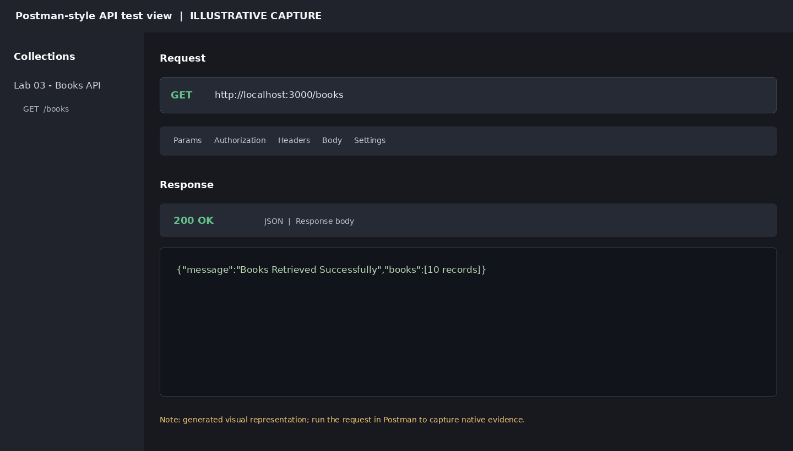

### Search query: search_q=the

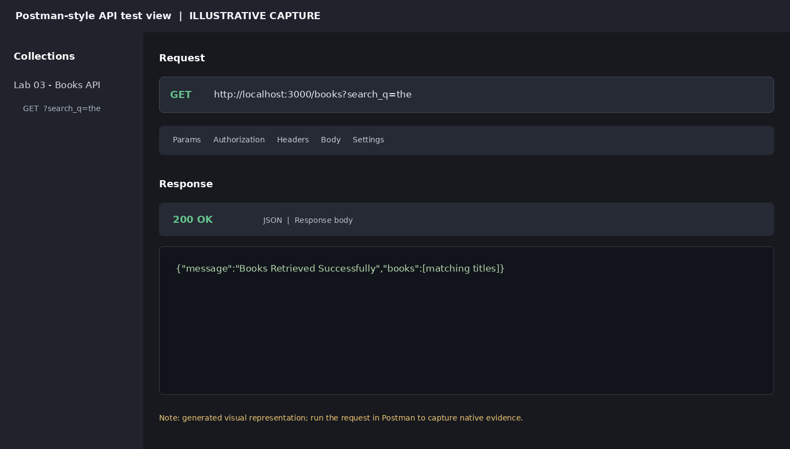

### Price range filter: min_price=300 and max_price=600

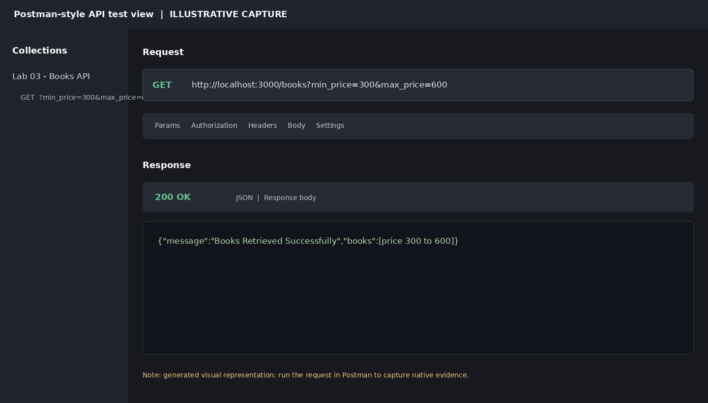

### Sorting and pagination: price DESC, limit 4


### GET a single book

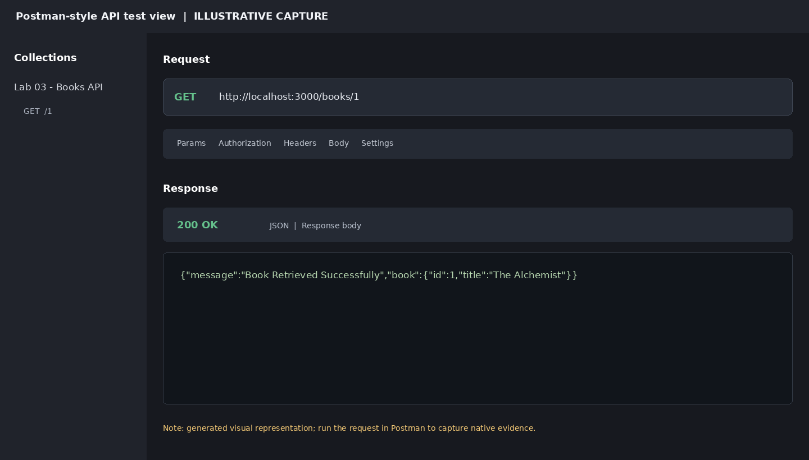

### GET book not found (404)


### POST add book success (201 Created)

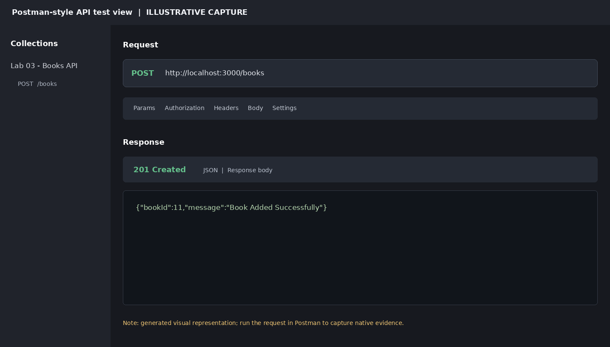

### POST missing title validation (400 Bad Request)

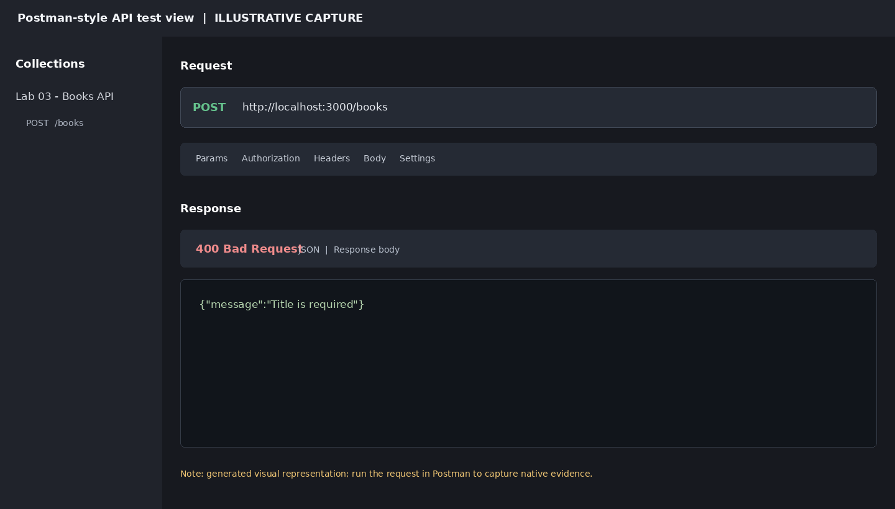

### POST non-numeric price validation (400 Bad Request)

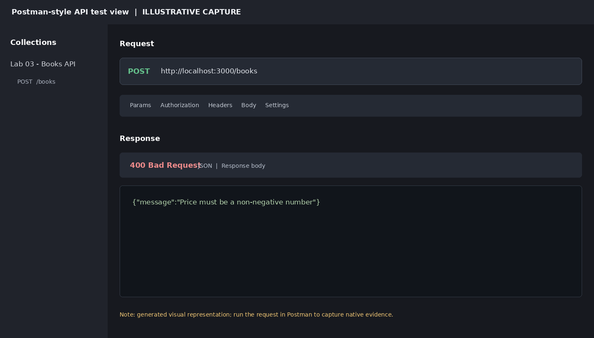

### PUT update success (200 OK)

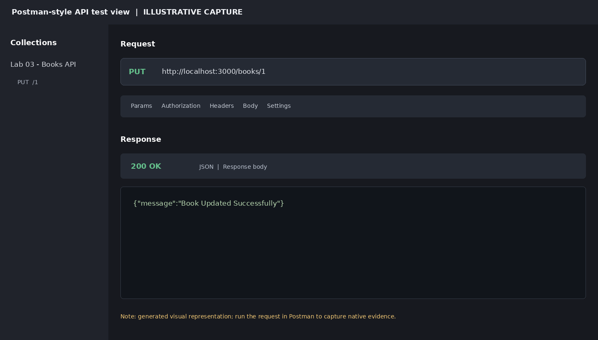

### PUT book not found (404 Not Found)

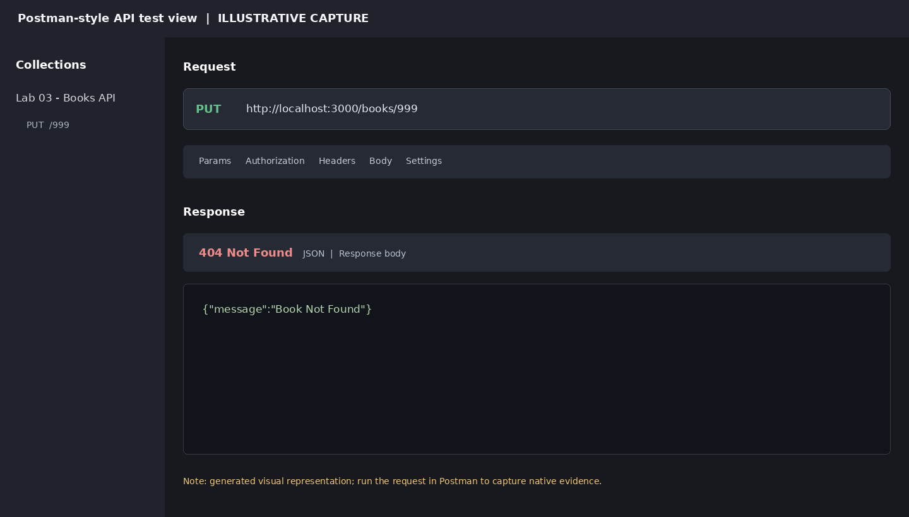

### DELETE success (200 OK)


### DELETE book not found (404 Not Found)

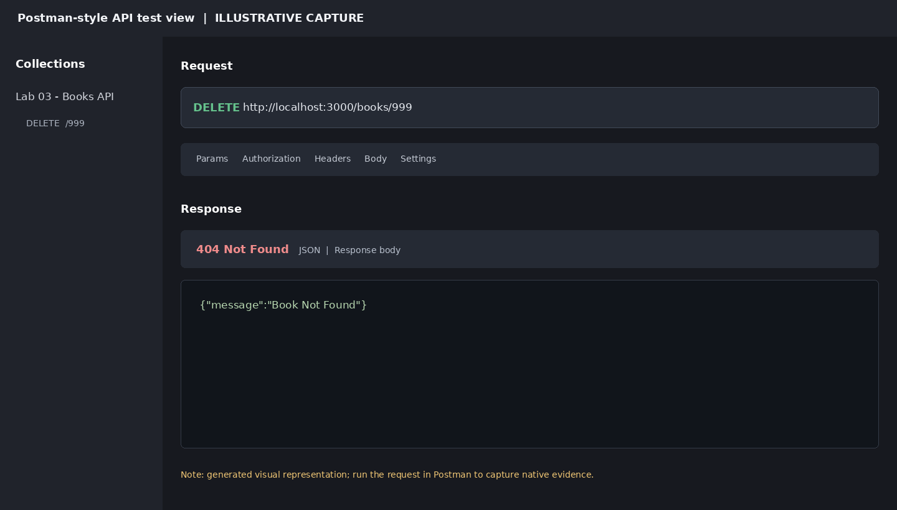

### SQLite table verification: seeded records

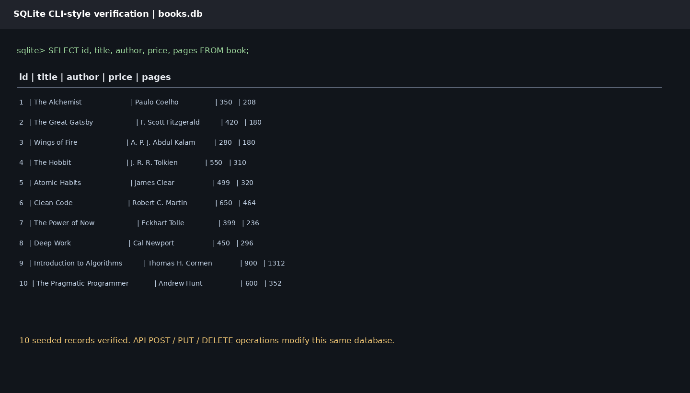

## SQLite Verification

The included `books.db` contains the `book` table and ten seeded sample records. To inspect it using the SQLite CLI:

```bash
sqlite3 books.db
.tables
.schema book
SELECT * FROM book;
.quit
```

The database is the same file used by the API. POST, PUT and DELETE operations therefore persist changes to `books.db`.

## Viva Questions and Answers

**1. What is the difference between a query parameter and a path parameter?**

A query parameter is used for optional filtering or sorting and appears after `?`, for example `/books?search_q=the`. A path parameter identifies a particular resource and is part of the URL path, for example `/books/3`.

**2. What is statelessness in REST?**

Statelessness means each client request contains all the information needed to process it. The server does not depend on stored session state from earlier requests.

**3. What is the difference between HTTP 400 and 404?**

HTTP 400 Bad Request means the request is invalid, such as a missing title or invalid price. HTTP 404 Not Found means the requested resource does not exist.

**4. Why are parameterized SQL queries used?**

They keep user-provided values separate from SQL instructions and help prevent SQL injection.

**5. Why validate `order_by` separately?**

SQL identifiers such as column names cannot be safely supplied as ordinary `?` values. The API checks the requested column against an allow-list before constructing the sort clause.

**6. What is pagination?**

Pagination divides a large result set into smaller portions. `LIMIT` controls the number of returned rows and `OFFSET` controls how many rows are skipped.

## Debugging Notes

- **EADDRINUSE:** Port 3000 is already in use. Stop the other Node process or use a free port, then restart the application.
- **Wrong import path:** Check the spelling and relative path of every `require()` statement. Ensure dependencies are installed in the project directory.
- **Table-name typo:** SQLite table names must match the schema. This project consistently uses the table name `book`.
- **Missing `await`:** Database operations are asynchronous. Use `await` before `db.get()`, `db.all()`, `db.run()` and initialization operations so the result is available before continuing.
- **Database file location:** `path.join(__dirname, "books.db")` ensures the API opens the database stored beside `app.js`, regardless of the terminal's current directory.

## Git Commands

Create a new GitHub repository named `backend-development-fundamentals-lab03`, then run these commands from the project root:

```bash
git init
git add .
git commit -m "Complete Lab 3 REST API and SQLite implementation"
git branch -M main
git remote add origin https://github.com/YOUR_GITHUB_USERNAME/backend-development-fundamentals-lab03.git
git push -u origin main
```

Replace `YOUR_GITHUB_USERNAME` with your GitHub username and use the repository URL GitHub gives you.

## Conclusion

This lab implements a REST API for managing books with Express.js and SQLite. It demonstrates CRUD operations, query-based searching, price filtering, sorting, pagination, input validation, parameterized SQL queries and debugging practices. The API uses appropriate HTTP status codes and JSON messages to communicate results consistently.
